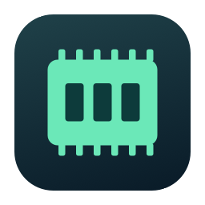
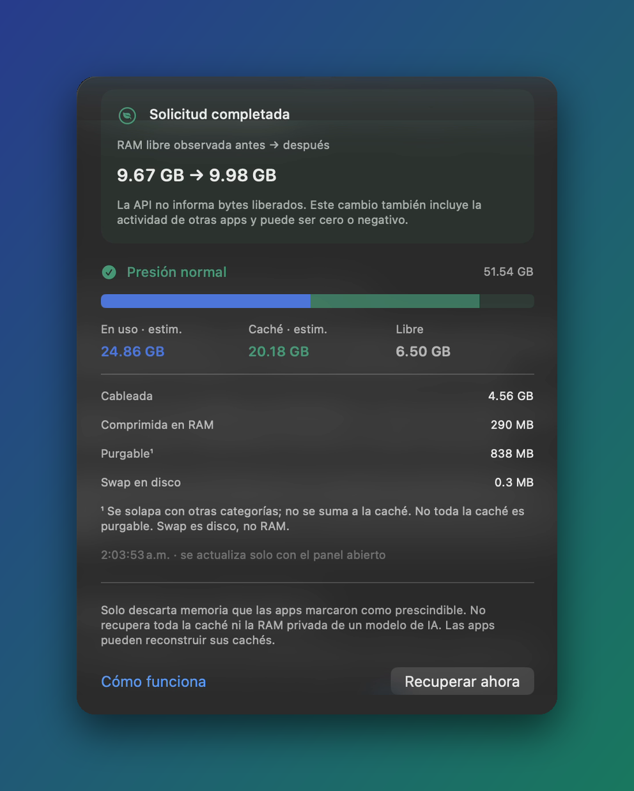

<div align="center">



# Free RAM Mac

**Your Mac's memory at a glance — and a one‑click purge of discardable RAM, right from the menu bar.**

[](https://github.com/RobiiAragon/FreeRAMMac/releases/latest)
[](https://github.com/RobiiAragon/FreeRAMMac/actions)


[](LICENSE)

[**Download**](https://github.com/RobiiAragon/FreeRAMMac/releases/latest) · [How it works](#how-it-works) · [Build from source](#build-from-source) · [Español](README.es.md)



</div>

---

## Highlights

- 📊 **RAM at a glance** — estimated memory usage as a percentage in the menu bar, refreshed every two seconds with monospaced digits so it never jitters.
- 🧹 **One quiet click** — a primary click asks macOS to discard *purgeable* memory in the background. No window, no report, no programs closed.
- 🔍 **Details when you need them** — a secondary click (or Control‑click) opens a panel with memory pressure, estimated file cache, wired, compressed, purgeable and swap.
- 🪶 **Featherweight** — a single timer, no helper processes, no Dock icon, no password prompts, no network access.
- 🚀 **Optional launch at login** — off by default. Turn on **Abrir al iniciar sesión** in the secondary‑click menu; it uses Apple's `SMAppService` (no helper, no LaunchAgent plist). If macOS asks for approval, the app takes you to System Settings → Login Items.
- 🔒 **Honest by design** — no fake "freed 4 GB!" animations. Readings come straight from kernel counters, and the app is upfront when there is nothing to purge.

> [!NOTE]
> The interface is currently in **Spanish**. English localization is on the roadmap.

## Install

1. Download **`Free-RAM-Mac-<version>.zip`** from the [latest release](https://github.com/RobiiAragon/FreeRAMMac/releases/latest).
2. Unzip it and drag **Free RAM Mac.app** to your **Applications** folder.
3. The app is ad‑hoc signed (not notarized). The first time, **right‑click → Open**, or run:

   ```sh
   xattr -dr com.apple.quarantine "/Applications/Free RAM Mac.app"
   ```

The memory chip appears in your menu bar as soon as the app launches.

## Usage

| Action | Result |
| --- | --- |
| **Click** the menu bar chip | Requests a purge of discardable memory, silently. Clicking again while a request is running does nothing. |
| **Right‑click / Control‑click** | Opens the options menu: memory details, help and quit. |
| **Details panel** | Shows pressure, swap and the full breakdown. Optional readings refresh only while the panel is open. |

If a reading fails, the chip shows `—%` and the reason appears in its tooltip, instead of presenting a stale number as current.

## How it works

### The purge

The action calls

```c
mach_vm_purgable_control(mach_task_self_, 0, VM_PURGABLE_PURGE_ALL, &state);
```

The kernel then discards **volatile objects that their owners already marked as disposable**. The request is system‑wide.

What it does **not** do: close, pause or restart processes; delete files; run `purge`; install helpers; create artificial memory pressure; or free wired memory, regular private memory (for example a local AI model) or swap. The kernel only reports success or failure — never bytes freed — so a successful request can legitimately free zero bytes. Apps may need to rebuild discarded caches.

> [!TIP]
> Used memory is not wasted memory. Under normal pressure, macOS manages RAM on its own and you rarely need to purge anything.

### The numbers

All readings are local: `host_statistics64`, `host_page_size`, `ProcessInfo.physicalMemory`, `vm.swapusage` and `kern.memorystatus_vm_pressure_level`.

| Metric | Formula |
| --- | --- |
| Free | `free_count − speculative_count` |
| Estimated cache | `external_page_count` (already includes speculative pages) |
| Estimated usage | physical RAM − free − cache *(the three add up to physical RAM)* |
| Menu bar % | estimated usage ÷ physical RAM × 100 |
| Wired / compressor | Shown as details of usage |
| Purgeable | Overlapping counter; not added to cache |
| Pressure | Kernel level — not derived from used RAM |

Figures intentionally do not mirror Activity Monitor one to one. Deep dives (Spanish): [Notes/MemoryMetrics.md](Notes/MemoryMetrics.md) · [Notes/Recovery.md](Notes/Recovery.md) · [PERFORMANCE.md](PERFORMANCE.md).

## Build from source

**Requirements:** macOS 14+ and a recent Xcode. No external packages and no developer team needed — the project uses local ad‑hoc signing.

```sh
git clone https://github.com/RobiiAragon/FreeRAMMac.git
cd FreeRAMMac
Tools/build.sh          # Release build → Build/Products/Release/Free RAM Mac.app
```

Or open **Free RAM Mac.xcodeproj**, choose the **Free RAM Mac** scheme and **My Mac**, and press <kbd>⌘</kbd><kbd>R</kbd>.

The Release build is a universal (arm64 + x86_64) binary. Verified on macOS 27 with Xcode 27; the Intel runtime and older macOS versions are untested.

### Checks

```sh
Tools/check.sh
```

Validates formulas, overlaps, overflow handling, real kernel readings and an **actual** global purge request, using a self‑owned purgeable page and a small private control page (no pressure, no privileges), plus the login‑item state mapping (nothing is registered). CI runs the same script on every pull request. Results: [Notes/Validation.md](Notes/Validation.md).

## Project layout

```
FreeRAMMac/   App sources — AppDelegate, MenuBarView, MemoryMonitor, MemoryMetrics, RecoveryService
Tests/        Standalone check executables
Tools/        build.sh, check.sh, icon generator
Notes/        Architecture, metrics, recovery and validation notes
```

## Roadmap

- [ ] English localization
- [ ] Developer ID signing and notarization
- [x] Optional launch at login

## License

[MIT](LICENSE) © RobiiAragon
